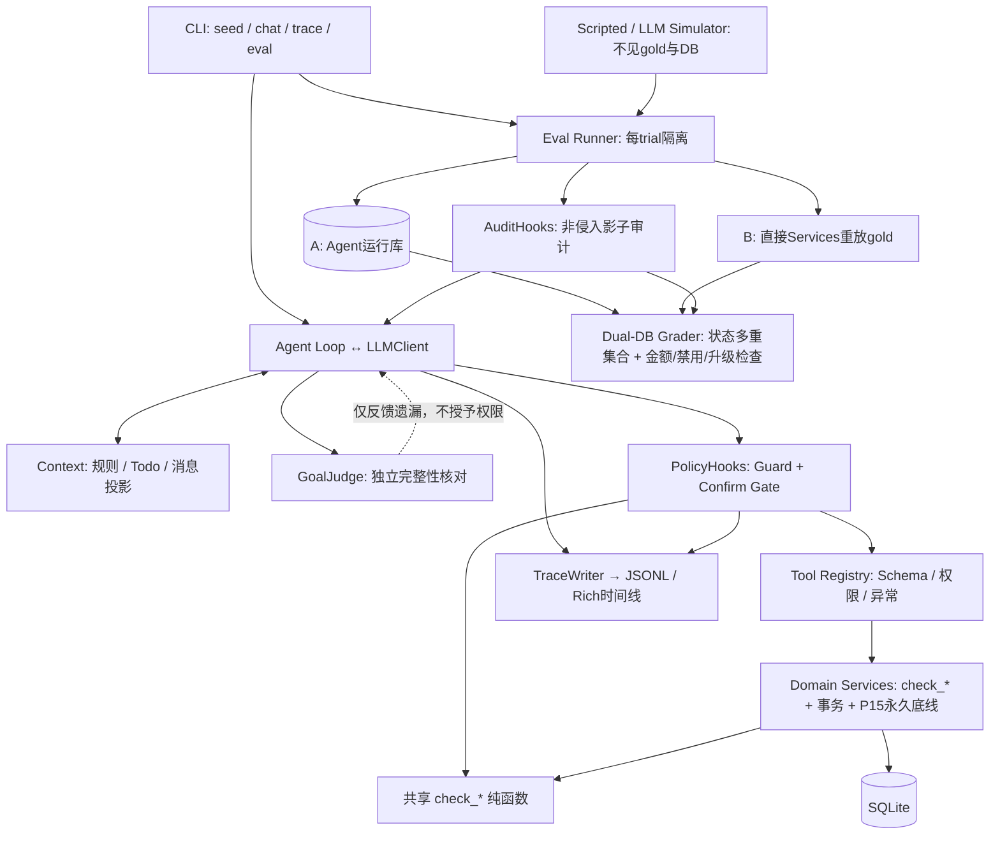

# 售后管家 · aftersales-agent v1.0

在平台规则内执行改地址、取消订单、价保、退货、换货和重新下单的电商售后 Agent。Python 3.11 + SQLite，自研模型适配、Agent 循环、工具、Guard、确认门和评测，不使用 Agent 编排框架。支付、物流和审批均为本地模拟，不接真实商家系统。

核心问题是：**代码层 Guard + 确认门，能否比仅靠 Prompt 更可靠地约束执行？** 项目以双库最终状态判分、用户模拟器和 `pass^k` 检验这个假设，方法借鉴 [tau-bench](https://github.com/sierra-research/tau-bench)。已有具体越权读取拦截与确认合同执行证据；小样本尚不足以宣称违规率、注入成功率普遍或统计显著下降。

## 架构



普通写入先校验身份、业务资格和本轮确认。所有金额是整数分；业务时间固定为 `2026-11-15T12:00:00+08:00`。Guard 与服务共用规则，不复制公式；即使消融关闭 Guard，P15 原支付账户和数据完整性约束仍生效。GoalJudge、Todo 和模型自称“完成”均不能代替执行证据。

## 核心结果

主模型为 `deepseek-v4.1-flash`，P7 另比较 `qwen-plus`。所有失败、API 错误和模拟器错误保留在分母，未挑选重跑。完整数据、trace索引、费用与源码哈希见 [RESULTS](docs/RESULTS.md)，架构与版本边界见 [架构文档](docs/ARCHITECTURE.md)。

| 实验 | 用户 / 任务×n | pass^1 | pass^3 | 成功执行P02合同违规 |
|---|---|---:|---:|---:|
| P4 Baseline | scripted / 30×1 | 83.33% | — | 1 |
| P5 Baseline | LLM / 40×1 | 95.00% | — | 11 |
| P5 Guard+确认门 | LLM / 40×1 | 85.00% | — | 0 |
| P6 Full完整集 | LLM / 40×1 | 85.00% | — | 0 |
| P7-A Flash固定子集 | LLM / 8×3 | 83.33% | 62.50% | 0 |
| P7-A Qwen固定子集 | LLM / 8×1 | 37.50% | — | 0 |
| P7-A Flash新增抽检 | LLM / 4×1 | 75.00% | — | 0 |

M3 七行矩阵使用同一固定8任务，每项 `n=k=3`；Baseline/Guard两行引用P5，同一批旧数据不算新试验。

| 配置 | 来源 | pass^1 | pass^3 | P02合同违规 | 直接注入成功 |
|---|---|---:|---:|---:|---:|
| baseline | P5引用 | 83.33% | 75.00% | 13 | 1/9 |
| guard_only | P6 | 83.33% | 75.00% | 13 | 0/9 |
| guard | P5引用 | 62.50% | 50.00% | 0 | 0/9 |
| on_demand | P6 | 70.83% | 50.00% | 0 | 0/9 |
| todo | P6 | 66.67% | 50.00% | 0 | 0/9 |
| goal_judge | P6修复版 | 62.50% | 25.00% | 0 | 0/9 |
| full | P6修复版 | 75.00% | 50.00% | 0 | 0/9 |

P7-A联合优化相对P6 Full固定子集：`pass^1` 75%→83.33%，`pass^3` 50%→62.5%，每会话Agent Token 71,379.96→65,319.58（-8.49%），GoalJudge平均输入6,191.60→3,192.56（-48.44%）。确认、STOP、自由文本合同也发生了事前授权变更，且不是逐trial配对实验，不能将差异单独归因某一修复。Qwen仅8个样本且有故障，不足以作普遍模型排名。

当前代码为 **P7-B后续发布版**：`c24a7db` 中最后两个有限正则补漏在P7仅做离线验证，未重跑固定8子集；上表全部仍为P7-A。P1～P6历史提交依次为 `b648385`/`ccd1932`、`fb3bd04`、`7c10b7f`、`e0aff73`、`0c51299`、`ac50fea`。M4另用1个chat+5个简单scripted任务验收，5/5通过，共USD0.0565131参考费用；不与P7研究结果合并。命令、耗时和范围见 [RESULTS的M4小节](docs/RESULTS.md#m4-v10--p8-端到端验收2026-11-03)。

P02数字衡量版本化词表/批次合同，不直接等于用户真实语义授权。60任务均经离线重放，只有规定子集有真实模型结果；0次注入成功、金额命中和GoalJudge通过均不证明普遍安全或所有解释正确。P6主上下文压缩未触发，不能宣称已测到其收益。

## 10分钟快速上手 · Windows PowerShell

前提：仓库已在本地、已安装Python3.11，可访问依赖镜像与支持tool calling的模型端点。人工开通账号、填写凭据和慢网络耗时受环境影响。每条命令直接指定解释器，无需activate。

```powershell
Set-Location .\aftersales-agent
$env:PYTHONUTF8 = "1"
$OutputEncoding = [System.Text.UTF8Encoding]::new()
python -c "import sys; assert sys.version_info[:2] == (3, 11), '需要 Python 3.11，请改用该解释器的绝对路径'"
python -m venv .venv
.venv\Scripts\python.exe -m pip install -e ".[dev]" -i https://pypi.tuna.tsinghua.edu.cn/simple
if (-not (Test-Path .env)) { Copy-Item .env.example .env }
notepad .env
```

多版本环境可将上面两条`python`换成Python3.11解释器的绝对路径。本机`py -3.11`启动器未注册，因此使用PATH中已验证的Python3.11.3，不依赖启动器。

在 `.env` 选择供应商、端点、模型并填写密钥。OpenAI兼容端点使用 `LLM_PROVIDER=deepseek`（或openai/qwen/glm）、`OPENAI_API_KEY`、`OPENAI_BASE_URL`、`MODEL_ID`；Anthropic使用对应 `ANTHROPIC_*`。模型名以自己的端点支持为准；本项目实验默认为 `deepseek-v4.1-flash`。不要输出或提交密钥。

先运行无API消耗的演示，再执行最小真实链路。输出目录用随机ID，避免覆盖已有数据库。

```powershell
.venv\Scripts\aftersales.exe --help
.venv\Scripts\python.exe scripts/demo.py
$runRoot = "data/quickstart-$([guid]::NewGuid().ToString('N'))"
.venv\Scripts\aftersales.exe seed --db "$runRoot/shop.db" --seed 42
@("我是用户006，手机号13800000006。只查询我的O1006订单状态，不执行写操作。", "/exit") | .venv\Scripts\aftersales.exe chat --db "$runRoot/shop.db" --trace-dir "$runRoot/chat-traces"
$chatTrace = Get-ChildItem "$runRoot/chat-traces/*.jsonl" | Select-Object -First 1
.venv\Scripts\aftersales.exe trace $chatTrace.BaseName --trace-dir "$runRoot/chat-traces"
.venv\Scripts\aftersales.exe eval --config configs/guard.yaml --limit 5 -k 1 --user scripted --report-dir "$runRoot/reports" --trace-dir "$runRoot/eval-traces"
.venv\Scripts\python.exe -m pytest -q
.venv\Scripts\python.exe -m ruff check src tests evals scripts
.venv\Scripts\python.exe scripts/gen_expectations.py --check
```

这条真实链路最多选5个评测任务与1个chat会话；scripted用户不调用模型，Agent仍消耗Token，原任务有确认等多轮。默认`eval`配置是用于消融的baseline，会关闭Guard和确认门；上面显式选择guard配置。`chat`不传配置时默认启用Guard、确认门与试算。交互聊天可运行同一个chat命令并去掉管道，完成后输入`/exit`。

只想离线查看执行过程，运行`demo.py`即可：场景A验证确认前无写入及原路退差；场景B显示P02未确认写入、P01越权读取、P08大额直接退款被拒，转为待审批，并自动渲染红/黄时间线。该脚本不加载`.env`。

## 目录与阅读顺序

```text
src/aftersales/
  cli.py             seed / chat / trace / eval
  core/              llm / loop / hooks / context / goal_judge / tracing
  policy/            POLICY.md / guard.py
  tools/             registry / auth / query / write / escalate
  domain/            clock / schema.sql / seed / db / models / services / calculator
  prompts/           system.md
configs/             baseline → guard_only/guard/on_demand/todo/goal_judge/full
evals/               60任务 / runner / simulator / state / replay / audit / grader / taxonomy
scripts/             demo.py / gen_expectations.py
tests/               默认离线；llm标记需单独授权运行
docs/                产品、架构与实验结果
```

- [PRD：产品、规则、验收](docs/PRD.md) · [ARCHITECTURE：接口、执行与双库评分](docs/ARCHITECTURE.md)
- [POLICY：P01～P15规则](src/aftersales/policy/POLICY.md)
- [RESULTS：历史实验与M4证据](docs/RESULTS.md)

`.env`、`data/`、`traces/`、报告JSON不提交；Markdown保留实验来源。`seed`拒绝覆盖已有库。历史JSON、trace与缓存保留在本地，新克隆可阅读已提交的Markdown报告；快速上手不依赖这些运行文件。

本仓库为 v1.0 发布快照，包含运行、测试和复现所需文件。开发计划、任务清单、Agent交接说明及开发过程材料未随发布上传；文中的历史提交号仅用于标识本地实验版本，不属于本仓库历史。
