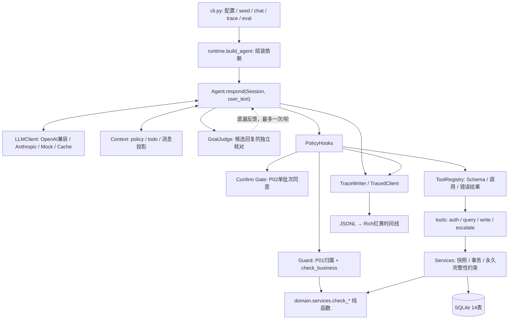
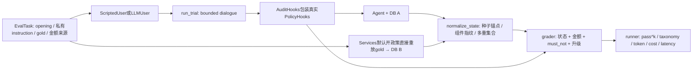

# 系统架构 · v1.0

本文描述已实现的P7-B及P8发布形态，历史实验版本以[RESULTS](RESULTS.md)的哈希为准。实现只使用Python3.11、已有SDK/Pydantic与标准库SQLite，不引入Agent编排框架。[PRD](PRD.md)定义范围，ADR（本地开发记录，未随发布上传）记录取舍。

## 分层与依赖

核心依赖通过构造参数注入：LLM、Clock、DB、配置、工具注册、hooks和trace。CLI负责输入输出，tools是薄封装，业务计算只在Services。裸Agent默认无操作Hooks适合单测，业务必须通过`build_agent`装配PolicyHooks；不能将裸Agent当成已开启安全配置。

## 模块职责与接口契约

| 模块 | 主要接口 | 行为与边界 |
|---|---|---|
| core/llm.py | `LLMClient.chat(system,messages,tools,temperature,max_tokens)->LLMResponse` | 中立Message/ToolCall/Usage；OpenAI兼容与Anthropic转换，网络/429最多3次尝试；Mock按序记录请求 |
| core/loop.py | `Agent.respond(session,user_text)->TurnResult` | 一轮中反复模型→工具，直到文本、上限、异常或转人工；Session持有身份/历史/todo/确认状态 |
| core/context.py | `selected_policy`、`with_todo`、`prepare_messages` | full或按需规则、内部update_todo、主Agent模型视图压缩，原历史不改 |
| core/goal_judge.py | `GoalJudge.check(...)->GoalVerdict或None` | 准备收尾时独立核对，每respond最多一次；只反馈遗漏，不执行、不判权限 |
| core/hooks.py | 五个hook点；`before_tool->Allow或Deny` | 严格参数预检、Guard、P02与verdict事件；异常参数交registry处理，不消耗同意 |
| policy/guard.py | `check_access`、`check_business` | P01认证/资源归属，业务检查复用Services纯函数，无第二套公式 |
| tools/registry.py | `@tool`、`ToolRegistry.execute`、`ToolContext` | Pydantic生成JSON Schema，read/write/escalate权限，异常隔离、输出截断 |
| domain/services.py | `check_*`、`Services` | 纯计算/校验返回结构化CheckResult；读快照与事务执行分离，P15和完整性永久生效 |
| core/tracing.py | `TraceWriter.emit/close`、`TracedClient.chat`、`render_trace` | 固定时钟时间戳、顺序号、真实性能计时、purpose/Token/成本、Rich安全渲染 |

`LLMResponse`包含text、tool_calls、stop_reason（end_turn/tool_use/max_tokens/error）、Usage与raw；raw只进trace。Message role为user/assistant/tool，工具结果必须关联tool_call_id。TurnResult含reply、tool_calls_made、stop_reason、usage、steps。配置由AgentConfig严格表达，CLI显式参数覆盖YAML中的Agent模型，环境配置按显式参数>进程环境>.env读取。

CachedClient用供应商/端点/模型身份及完整规范化请求SHA256作key，只读写完整end_turn/tool_use；旧max_tokens/error文件忽略。临时文件后原子替换。缓存可复现对应trial，逻辑Token仍计入用量，新成本为0，不能当成新独立样本。

## 一轮执行与恢复

1. respond追加用户消息，before_llm初始化一次确认候选；投影上下文并请求LLM。
2. 工具调用依次执行。未知工具、参数错误、工具异常变成is_error结果；模型可继续纠正。
3. before_tool先预检参数，再核对Guard、确认门，拒绝不执行，回传`[POLICY_VIOLATION Pxx]`。
4. registry调用薄工具→Services，记录实际结果。工具文本先JSON转义再放入`<tool_result>`定界，内嵌指令不产生权限。
5. 完整无工具文本作为候选；收尾且启用GoalJudge时核对一次，有遗漏则注入数据反馈继续，正常等待确认/身份时不催促执行。
6. 结束回合清空许可。转人工成功立即关闭Session，同批后续调用只补SESSION_ENDED错误，不执行。

max_tokens使整批调用不执行，恢复提示只消费一次；连续第三次同名同参调用（忽略call ID/字典顺序）不执行并反馈死循环；max_steps默认30，steps按模型请求计数。普通一批工具顺序执行，但不保证整批原子性；单个Services事务原子，已成功项不能靠回滚下一工具撤销。

## 两层规则防线与永久底线

软层：system中的POLICY、按需lookup_policy、工具数据边界与模型解释。硬层：Guard执行前拒绝 + P02确认门；二者独立开关供消融。Services默认也检查政策，ToolContext在消融时显式传enforce_policy=config.guard，避免baseline仍受同一政策硬拦截而掩盖实验变量。

共享`check_modify_address/check_cancel_order/check_price_protection/check_return/check_exchange/check_create_order`等纯校验接收明确模型、时间和金额快照，不写库。Guard读取快照后调用；Services在事务内再调用并执行。库存和退款余额等完整性不随实验开关取消。下单校验的实际纯函数名为`check_create_order`，Services.check_purchase负责装载输入。

确认状态在Session：最近用户前紧邻的assistant须为无tool_calls文本；heuristic或独立小模型判同意；直接否定优先。一个新用户输入只初始化一次，read不消耗；首个获准write消费，当前模型响应中的其余write可继续，但逐项业务校验；下一before_llm清除confirmed_batch，不能从同一用户句子重新授予同意。参数/Guard拒绝不消耗，服务执行失败已消耗；身份变化使许可失效。

P7-B仅豁免有限完整边界分句，仍需肯定词；“不取消订单”即使伴随确认也明确拒绝cancel_order。它不是通用语义授权器，也没有将方案和工具参数逐字段签名绑定。escalate不等同write：审批和人工记录不退款，无P02写门，但仍受资源访问校验。

未认证只允许认证、规则查阅、匿名转人工与内部update_todo；其他真实查询仍需身份。用户/订单参数均校验归属。认证前转人工允许handoffs.user_id=NULL，可能与期望关联用户的评测不一致，不能悄悄改grader修正它。

P15由服务退款目标检查及数据库关联约束兜底，退款只能订单原支付方式，包括同一用户的其他账户也不允许。关闭Guard仍拒绝，服务拒绝rule_ids/source进入trace。金额全部int分：最大余数券分摊、half-up部分退款、退完剩余件数直接退剩余余额；价保和便宜换货计入累计退款，更贵换货只记录待补款。

## 上下文与核对视图

full把POLICY全文放system；on_demand放11主题目录及P01/P02/P11原文。todo仅为会话状态。主Agent超过80消息或32000工具字符时压缩较早普通read，保留最近两轮、认证、写入、升级；完整原始历史保留，call/result关系不删。P6真实样本均未触发，不将其当作已测成本收益。

GoalJudge采用另一投影：省略普通read正文和默认空字段，保留用户/助手、调用名/参数、认证/写入/升级、错误和未知结果。按最近批次解析重复工具ID，歧义结果保留。它降低核对输入，也降低独立验证查询细节的能力；截断/异常返回None并记录complete=null，保留原候选，不假称已经核验。

## 双库评测架构

每trial用同seed/Clock建立A/B全新库；B直接Services重放，绝不经过Agent工具或Guard。gen_expectations先重放gold，从指定OperationResult产生must_mention；runner在付费调用前校验全部期望。用户模拟器看不到gold、DB或判分结果，不能拿期望终态给模拟器导航。

`state.py`比较orders、order_items、skus.stock、user_coupons、aftersales、refunds、approvals、handoffs；去掉自增ID和created_at，表按行多重集合比较。种子记录仍用稳定资源锚点，新记录按订单组件、商品行、售后及子退款的指纹建立身份，关联外键同步重映射，避免“执行顺序不同”误判，也避免交换退款归属却被误当同一终态。审批args里的关联ID递归规范化。

顶层reason/summary忽略措辞但各要求字段须为非空字符串。P7-B审批args第一层reason存在时也须非空、比较忽略措辞；order_id/items/order_item_id/qty/new_sku_id/address等结构字段及列表仍精确。无效文本独立记录，即使A/B都为空也失败；其他嵌套结构不随意删除。

`audit.py`不改变Agent决策；观察成功工具结果，调用同一访问/业务校验及影子heuristic确认门，记录实际越权read、未确认write、未请求write和注入。被真实Guard挡住的尝试不能算成功违规，也不能消费影子确认。注入的“未请求”参数比较仍有合同局限，需抽查trace。

`simulator.py`首轮固定opening，后续只见profile/instruction与可见对话，最多20轮；禁止泄露instruction或编造诉求。只有完整无工具非空回复可投递，STOP本地消费；短已知收尾可混合STOP，新请求/问号/未知文本仍保守报错，原文泄露检测也保留。转人工立即结束。错误不剔除分母、不补跑。

Agent、确认分类与GoalJudge计Agent目的用量；模拟器用purpose=simulator，模型名/Token/费用独立。CLI覆盖Agent模型不会默认改模拟器模型，模拟器缺省取.env模型。缓存按源码/数据集/配置/用户模式/模拟器身份/任务/trial隔离。报告JSON记录可复核明细，Markdown提交，原JSON/trace/cache忽略。

`pass^k`用组合数而不是简单连乘；金额仅检查回复中等价值出现，不评估每句业务解释的语义。taxonomy可多标签，不能把标签数相加当失败任务数。详细定义见[PRD](PRD.md)，历史版本与错误分母见[RESULTS](RESULTS.md)。

## 发布与复现

wheel包含aftersales、evals及SQL/Markdown/YAML资源，排除运行报告。配置、测试与演示脚本从源码仓库使用；CLI默认tasks/config相对当前目录，因此快速上手要求位于仓库根。独立wheel导入与包内资源另做验证。业务时钟固定不影响perf_counter性能计时；trace运行ID用UUID防止固定时间冲突。

默认离线演示真实调用build_agent、PolicyHooks、Services与SQLite，Mock只替换模型；不经.env、不连模型。M4真实链路只用授权的1个chat+5个scripted trial，记录费用、耗时和实际结果；不把演示当成功率实验。后续生产所需的真实鉴权、支付幂等、并发控制、审批工作台与账户隔离留给v2。
