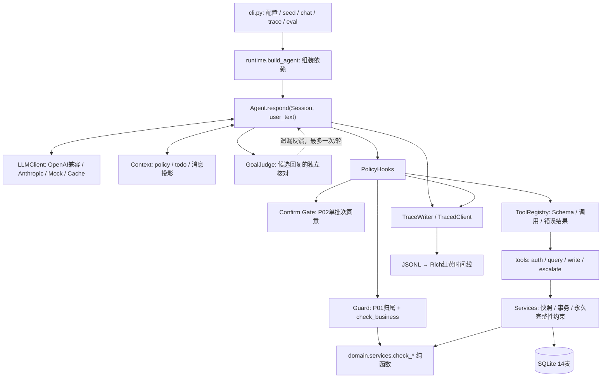
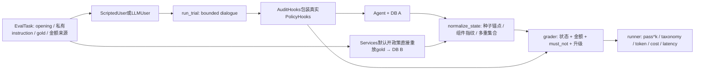
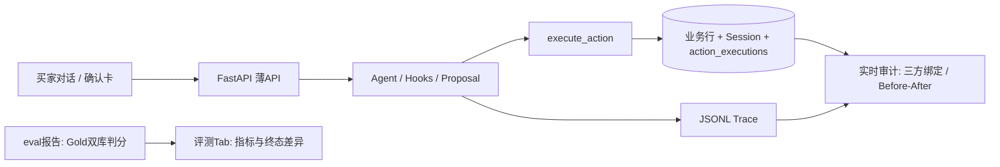
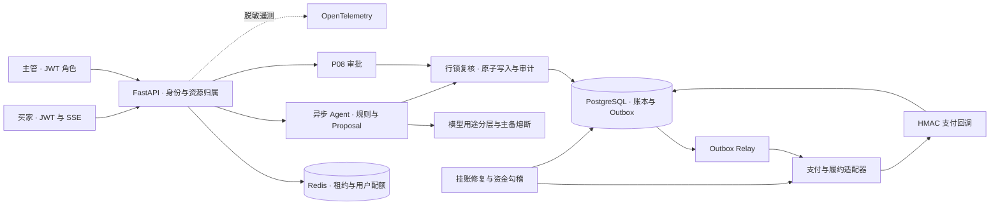

# 系统架构 · v3.0.0

项目使用 Python 3.11 自研 Agent 执行层，不引入任何重型 Agent 编排框架。v1 建立 Guard 硬校验、确认门与双库终态判分；v2 把确认升级为服务端 Proposal 逐字段绑定，加入单库原子提交、动作幂等恢复和双栏审计工作台；v3 在共享规则和整数分金额计算之上增加 PostgreSQL 16 + Redis 7 生产高并发路径，同时完整保留 SQLite 离线评测与工作台。下文先说明 v1、v2 的执行和评测契约，再展开 v3 的生产边界。 [产品范围](PRD.md) · [历史实验](RESULTS.md)

## 分层与依赖

核心依赖通过构造参数注入：LLM、Clock、DB、配置、工具注册、hooks和trace。CLI负责输入输出，tools是薄封装，业务计算只在Services。裸Agent默认无操作Hooks适合单测，业务必须通过`build_agent`装配PolicyHooks；不能将裸Agent当成已开启安全配置。

## 模块职责与接口契约

| 模块 | 主要接口 | 行为与边界 |
|---|---|---|
| core/llm.py | `LLMClient.chat(system,messages,tools,temperature,max_tokens)->LLMResponse` | 中立Message/ToolCall/Usage；OpenAI兼容与Anthropic转换，网络/429最多3次尝试；Mock按序记录请求 |
| core/loop.py | `Agent.respond(session,user_text)->TurnResult` | 一轮中反复模型→工具，直到文本、上限、异常或转人工；Session持有身份/历史/todo/确认状态 |
| core/context.py | `selected_policy`、`with_todo`、`prepare_messages` | full或按需规则、内部update_todo、主Agent模型视图压缩，原历史不改 |
| core/goal_judge.py | `GoalJudge.check(...)->GoalVerdict或None` | 准备收尾时独立核对，每respond最多一次；只反馈遗漏，不执行、不判权限 |
| core/hooks.py | 五个hook点；`before_tool->Allow或Deny` | 严格参数预检、Guard、P02与verdict事件；异常参数交registry处理，不消耗同意 |
| policy/guard.py | `check_access`、`check_business` | P01认证/资源归属，业务检查复用Services纯函数，无第二套公式 |
| tools/registry.py | `@tool`、`ToolRegistry.execute`、`ToolContext` | Pydantic生成JSON Schema，read/write/escalate权限，异常隔离、输出截断 |
| domain/services.py | `check_*`、`Services` | 纯计算/校验返回结构化CheckResult；读快照与事务执行分离，P15和完整性永久生效 |
| core/tracing.py | `TraceWriter.emit/close`、`TracedClient.chat`、`render_trace` | 固定时钟时间戳、顺序号、真实性能计时、purpose/Token/成本、Rich安全渲染 |

`LLMResponse`包含text、tool_calls、stop_reason（end_turn/tool_use/max_tokens/error）、Usage与raw；raw只进trace。Message role为user/assistant/tool，工具结果必须关联tool_call_id。TurnResult含reply、tool_calls_made、stop_reason、usage、steps。配置由AgentConfig严格表达，CLI显式参数覆盖YAML中的Agent模型，环境配置按显式参数>进程环境>.env读取。

CachedClient用供应商/端点/模型身份及完整规范化请求SHA256作key，只读写完整end_turn/tool_use；旧max_tokens/error文件忽略。临时文件后原子替换。缓存可复现对应trial，逻辑Token仍计入用量，新成本为0，不能当成新独立样本。

## 一轮执行与恢复

1. respond追加用户消息，before_llm初始化一次确认候选；投影上下文并请求LLM。
2. 工具调用依次执行。未知工具、参数错误、工具异常变成is_error结果；模型可继续纠正。
3. before_tool先预检参数，再核对Guard、确认门，拒绝不执行，回传`[POLICY_VIOLATION Pxx]`。
4. registry调用薄工具→Services，记录实际结果。工具文本先JSON转义再放入`<tool_result>`定界，内嵌指令不产生权限。
5. 完整无工具文本作为候选；收尾且启用GoalJudge时核对一次，有遗漏则注入数据反馈继续，正常等待确认/身份时不催促执行。
6. 结束回合清空许可。转人工成功立即关闭Session，同批后续调用只补SESSION_ENDED错误，不执行。

max_tokens使整批调用不执行，恢复提示只消费一次；连续第三次同名同参调用（忽略call ID/字典顺序）不执行并反馈死循环；max_steps默认30，steps按模型请求计数。普通一批工具顺序执行，但不保证整批原子性；单个Services事务原子，已成功项不能靠回滚下一工具撤销。

## 两层规则防线与永久底线

软层：system中的POLICY、按需lookup_policy、工具数据边界与模型解释。硬层：Guard执行前拒绝 + P02确认门；二者独立开关供消融。Services默认也检查政策，ToolContext在消融时显式传enforce_policy=config.guard，避免baseline仍受同一政策硬拦截而掩盖实验变量。

共享`check_modify_address/check_cancel_order/check_price_protection/check_return/check_exchange/check_create_order`等纯校验接收明确模型、时间和金额快照，不写库。Guard读取快照后调用；Services在事务内再调用并执行。库存和退款余额等完整性不随实验开关取消。下单校验的实际纯函数名为`check_create_order`，Services.check_purchase负责装载输入。

确认状态在Session：最近用户前紧邻的assistant须为无tool_calls文本；heuristic或独立小模型判同意；直接否定优先。一个新用户输入只初始化一次，read不消耗；首个获准write消费，当前模型响应中的其余write可继续，但逐项业务校验；下一before_llm清除confirmed_batch，不能从同一用户句子重新授予同意。参数/Guard拒绝不消耗，服务执行失败已消耗；身份变化使许可失效。

v1.0兼容确认门（proposal_gate=False）在P7-B仅豁免有限完整边界分句，仍需肯定词；“不取消订单”即使伴随确认也明确拒绝cancel_order。它不是通用语义授权器，也没有将方案和工具参数逐字段签名绑定。escalate不等同write：审批和人工记录不退款，无P02写门，但仍受资源访问校验。

未认证只允许认证、规则查阅、匿名转人工与内部update_todo；其他真实查询仍需身份。用户/订单参数均校验归属。认证前转人工允许handoffs.user_id=NULL，可能与期望关联用户的评测不一致，不能悄悄改grader修正它。

P15由服务退款目标检查及数据库关联约束兜底，退款只能订单原支付方式，包括同一用户的其他账户也不允许。关闭Guard仍拒绝，服务拒绝rule_ids/source进入trace。金额全部int分：最大余数券分摊、half-up部分退款、退完剩余件数直接退剩余余额；价保和便宜换货计入累计退款，更贵换货只记录待补款。

## 上下文与核对视图

full把POLICY全文放system；on_demand放11主题目录及P01/P02/P11原文。todo仅为会话状态。主Agent超过80消息或32000工具字符时压缩较早普通read，保留最近两轮、认证、写入、升级；完整原始历史保留，call/result关系不删。P6真实样本均未触发，不将其当作已测成本收益。

GoalJudge采用另一投影：省略普通read正文和默认空字段，保留用户/助手、调用名/参数、认证/写入/升级、错误和未知结果。按最近批次解析重复工具ID，歧义结果保留。它降低核对输入，也降低独立验证查询细节的能力；截断/异常返回None并记录complete=null，保留原候选，不假称已经核验。

## 双库评测架构

每trial用同seed/Clock建立A/B全新库；B直接Services重放，绝不经过Agent工具或Guard。gen_expectations先重放gold，从指定OperationResult产生must_mention；runner在付费调用前校验全部期望。用户模拟器看不到gold、DB或判分结果，不能拿期望终态给模拟器导航。

`state.py`比较orders、order_items、skus.stock、user_coupons、aftersales、refunds、approvals、handoffs；去掉自增ID和created_at，表按行多重集合比较。种子记录仍用稳定资源锚点，新记录按订单组件、商品行、售后及子退款的指纹建立身份，关联外键同步重映射，避免“执行顺序不同”误判，也避免交换退款归属却被误当同一终态。审批args里的关联ID递归规范化。

顶层reason/summary忽略措辞但各要求字段须为非空字符串。P7-B审批args第一层reason存在时也须非空、比较忽略措辞；order_id/items/order_item_id/qty/new_sku_id/address等结构字段及列表仍精确。无效文本独立记录，即使A/B都为空也失败；其他嵌套结构不随意删除。

`audit.py`不改变Agent决策；观察成功工具结果，调用同一访问/业务校验及影子heuristic确认门，记录实际越权read、未确认write、未请求write和注入。被真实Guard挡住的尝试不能算成功违规，也不能消费影子确认。注入的“未请求”参数比较仍有合同局限，需抽查trace。

`simulator.py`首轮固定opening，后续只见profile/instruction与可见对话，最多20轮；禁止泄露instruction或编造诉求。只有完整无工具非空回复可投递，STOP本地消费；短已知收尾可混合STOP，新请求/问号/未知文本仍保守报错，原文泄露检测也保留。转人工立即结束。错误不剔除分母、不补跑。

Agent、确认分类与GoalJudge计Agent目的用量；模拟器用purpose=simulator，模型名/Token/费用独立。CLI覆盖Agent模型不会默认改模拟器模型，模拟器缺省取.env模型。缓存按源码/数据集/配置/用户模式/模拟器身份/任务/trial隔离。报告JSON记录可复核明细，Markdown提交，原JSON/trace/cache忽略。

`pass^k`用组合数而不是简单连乘；金额仅检查回复中等价值出现，不评估每句业务解释的语义。taxonomy可多标签，不能把标签数相加当失败任务数。详细定义见[PRD](PRD.md)，历史版本与错误分母见[RESULTS](RESULTS.md)。

## 发布与复现

wheel包含aftersales、evals及SQL/Markdown/YAML资源，排除运行报告。配置、测试与演示脚本从源码仓库使用；CLI默认tasks/config相对当前目录，因此快速上手要求位于仓库根。独立wheel导入与包内资源另做验证。业务时钟固定不影响perf_counter性能计时；trace运行ID用UUID防止固定时间冲突。

默认离线演示调用 `build_agent`、`PolicyHooks`、`Services` 和 SQLite，由 Mock 提供模型响应。M4 的真实模型验收使用 1 次聊天与 5 个脚本用户试验，并记录实际结果、费用和耗时。历史实验以报告中的源码哈希为准。 [M4 验收](RESULTS.md#m4-v10--p8-端到端验收2026-11-03)

## M5～M7 增量：绑定授权、恢复与双栏审计工作台

当 `confirm_gate=True, proposal_gate=True` 时，模型先调用 `propose_actions`，服务端用写工具相同的严格Schema及Services.check_*生成ActionProposal。仅最新pending版本可整份批准；部分同意或修改先拒绝旧方案，再生成v+1重新确认。写入前匹配tool_name和全部结构化canonical_args（reason仅非空）、复核业务前提与试算金额。旧版确认门仍通过proposal_gate=False可复现；取消退券后重拍须分步提案，不在内存模拟依赖写入。

`execute_action` 用 `(session_id, proposal_id, action_id)` 唯一键，在同一SQLite事务内提交业务变更、before/after快照、OperationResult、Session及授权消费；同键同参读取原结果，同键异参P02。事务不跨LLM请求。Session完整JSON以revision检测过期更新，CLI与Web可恢复；JSONL trace通过session_traces关联。实现见 [Proposal](../src/aftersales/policy/proposal.py)、[动作执行](../src/aftersales/core/execution.py)与[会话存储](../src/aftersales/core/session_store.py)。

原生前端由 `web/app.py` 的 `GET /` 与 `/static` 托管，Hatch wheel 显式打包，无前端构建依赖。左栏通过 sessions/messages/decision 操作统一 Agent 与授权入口，服务端返回订单快照、审批记录、多版本方案、执行记录和关联Trace。前端不判断业务资格、不计算退款，仅把整数分格式化显示。

新增 `POST /api/demos/{1|2|3}` 在原库相邻的 `<db-stem>-demos/<session_id>.db` 创建独立seed库；`POST /api/sessions/{id}/demo/advance` 按持久化游标执行下一步。只接受场景1～3和严格生成的会话路径，刷新/重启按会话ID恢复同一演示库。剧本使用MockLLM，但调用真实Agent、确认门、Services与执行事务；没有API Token消耗。仅演示游标新增辅助表，14业务表与旧种子/评分schema保持冻结。

实时三方表只把同一Proposal动作与相应执行记录连接，未提交的尝试保留在Trace；字段Diff来自action_executions原始快照，不从模型回复推测。评测Tab只显示报告中的grade.database_diff（Agent缺失Gold行/多余行），终态一致时明确显示空差异。任务完成度、业务正确性和代码拦截是不同证据，不在UI里混为同一“安全率”。

`serve --offline` 注入本地说明型客户端。SQLite 本地模式用会话 ID 访问演示会话，确认卡 API 启用 `guard`、`confirm_gate` 和 `proposal_gate`。自由文本通过 DOM 文本节点渲染。生产 API 的会话身份和归属由 JWT 校验。

## M8～M10 · v3 生产执行

| 边界 | 离线评测与工作台 | 生产 API |
|---|---|---|
| 数据与时钟 | SQLite、`FixedClock`、每个评测试验独立双库 | PostgreSQL 16、`WallClock`、原生异步连接池 |
| 会话与身份 | 进程内按会话互斥，本地演示身份验证 | JWT 绑定会话归属，Redis 令牌租约，PG `revision` 复核 |
| 结算与审计 | 本地确定性结算，JSONL Trace | 异步渠道与回调，PG 审计表、PII 脱敏及 OpenTelemetry |

- **M8 异步回合与流式网关**。SSE 与普通消息接口复用同一套 [`AsyncAgent`](../src/aftersales/core/loop.py)。等待主模型、确认分类器或目标核对前归还数据库连接，做到慢 I/O 期间零连接与零事务持有。写动作在短事务中完成，断连后可沿会话检查点和动作幂等记录恢复。10 个独立会话各等待模拟模型 0.3 秒，并发总耗时 0.560 秒。
- **M9 强一致并发、多租户身份与可观测性**。[`storage.py`](../src/aftersales/domain/storage.py) 以 `greenlet` 非阻塞桥接 `psycopg` `AsyncConnectionPool`，使 SQLite 与 PostgreSQL 共享同一套业务服务。写入先锁订单，再按 SKU 主键升序加锁，并核对条件原子更新的影响行数。退款同时受原支付方式复合外键、[`pg_schema.sql`](../src/aftersales/domain/pg_schema.sql) 订单额度账本触发器（`reserve_refund()`）和商品行余额约束。[`redis_coord.py`](../src/aftersales/core/redis_coord.py) 维护会话租约、UID 滑动窗口、在途上限、日成本配额及按 PG `revision` 验证的缓存。[`security.py`](../src/aftersales/web/security.py) 与 [`privacy.py`](../src/aftersales/core/privacy.py) 校验 JWT 签名、发行方、受众、角色和资源归属，并对审计日志与 OpenTelemetry 遥测做白名单投影脱敏。20 路抢单只成功 1 笔，40 笔交叉 SKU 订单全部提交且零死锁。
- **M10 异步结算、自动对账与主管审批闭环**。退款占用、动作记录、前后快照和 [`outbox.py`](../src/aftersales/core/outbox.py) 事件同事务提交。Worker 用 `FOR UPDATE SKIP LOCKED` 领取事件（带数据库租约接续），取消订单须先经履约拦截确认再回补库存与发起退款，并以全局唯一 `execution_key` 作为渠道幂等键，支持指数退避和死信工单。[`webhooks.py`](../src/aftersales/web/webhooks.py) 用 HMAC-SHA256、5 分钟时间窗和事件去重表推进终态，渠道失败保留占用额度并创建人工工单。[`reconciliation.py`](../src/aftersales/domain/reconciliation.py)（`aftersales reconcile`）主动查单修复超时挂账并勾稽渠道完整结算单（发现差异自动阻断该单后续自动打款）。[`admin.py`](../src/aftersales/web/admin.py) 主管审批在锁内复核订单和原申请金额，以 `approval:{id}` 幂等进入同一结算路径并通知原会话。[`llm_router.py`](../src/aftersales/core/llm_router.py) 按 `agent`、`confirmation` 和 `goal_judge` 配置主备熔断链，确认分类器受 3 秒总超时保护。

### v3 封版验证与持久性边界

921 项默认离线测试通过，Windows 与 Linux Compose 各有 18 项真实 PostgreSQL 16 + Redis 7 集成测试通过，三套共 74 题金额重放零差异。在 [`scripts/load_test.py`](../scripts/load_test.py) 的 20 路并发、60 操作混合故障压测中，Linux Compose 端到端 P95 从优化前的 1061.97 ms 降至 618.74 ms（P50 为 98.98 ms）。首笔审批事务应用 SQL 由 21 条减至 11 条：新建 Schema 冷态首笔约 35 ms（Linux）/ 47 ms（Windows，含首次表目录加载、7 表 JSONB 快照计划编译与 PL/pgSQL 触发器编译），预热稳态下第 2 笔的 11 条业务 SQL 合计约 11.8 ms，其余约 8～12 ms 为 `COMMIT` 阶段的延迟外键闭环校验与 Docker 卷 `synchronous_commit=on` WAL 物理刷盘耗时。生产账本严格保留 `synchronous_commit=on`、延迟外键与事务内前后快照，确保资金占用、动作证据与 Outbox 拥有同一持久化边界。

- **M11 输出侧合规绊线与动态状态漂移评测**。生产网关默认开启 [`output_guard.py`](../src/aftersales/policy/output_guard.py)，在服务端方案卡拼接前按本轮成功工具回执确定性拦截四类输出违规（`PROCESSING_FINALITY_CLAIM`、`APPROVAL_REFUNDED_CLAIM`、`UNAUTHORIZED_COMPENSATION`、`INTERNAL_TAG_LEAK`），触发时撤回 SSE 临时预览并允许单次纯文本重写，再次违规或异常降级为确定性安全兜底文案。评测层新增 [`evals/world.py`](../evals/world.py) 与 `evals/tasks_drift/`（6 题），在指定回合后向独立 SQLite 注入发货、售罄、调价与券失效事件；18 个真实多轮会话（`n=k=3`）实测快照漂移拦截 16 次、未确认写入 0 次、双库终态正确率 94.44%（17/18）。 [动态漂移实测详情](RESULTS.md#m11-动态状态漂移实测)
